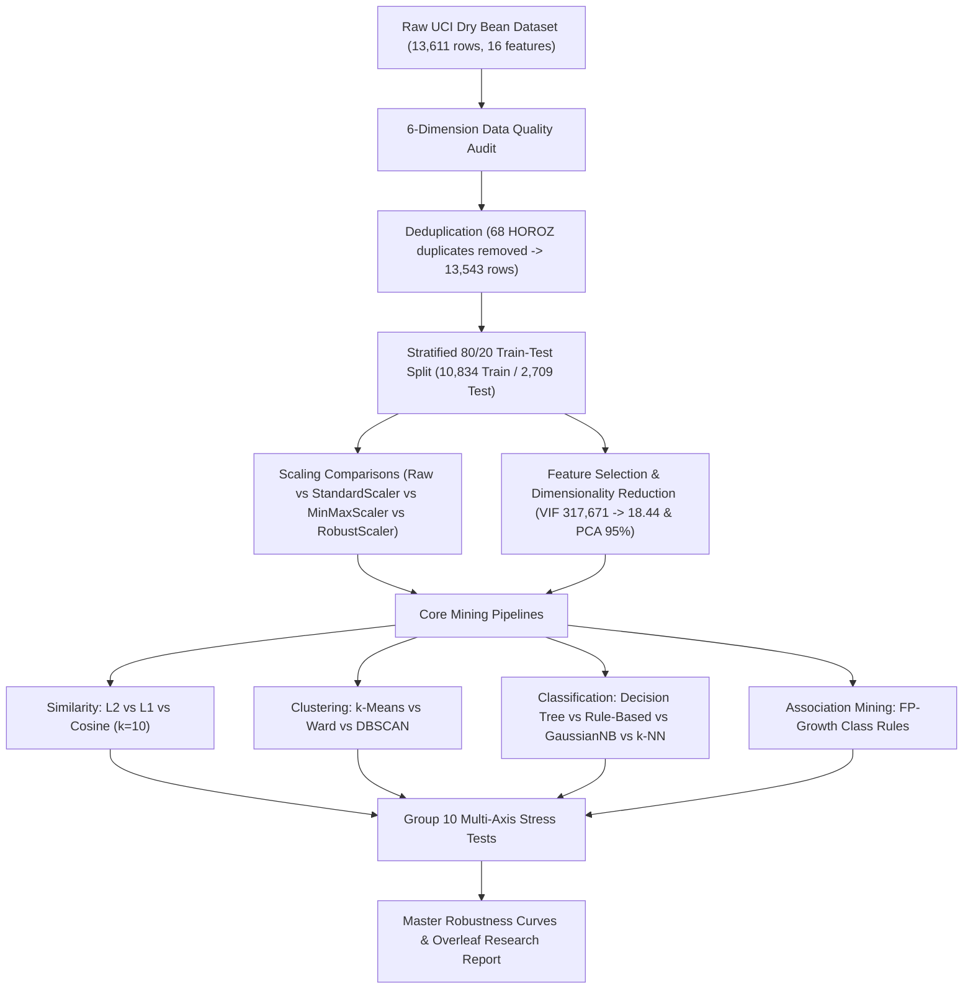
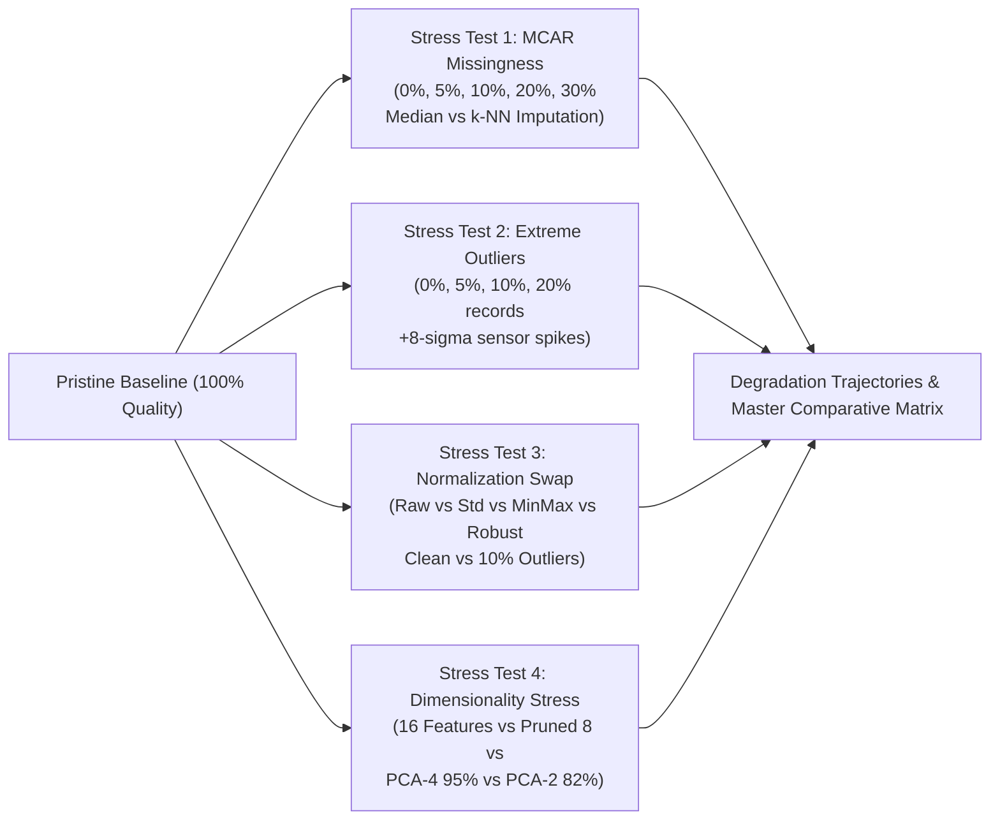
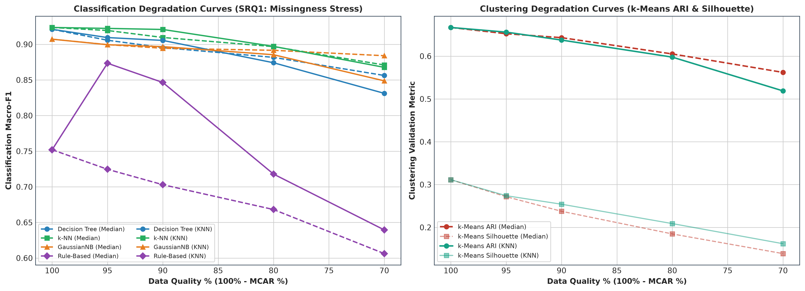
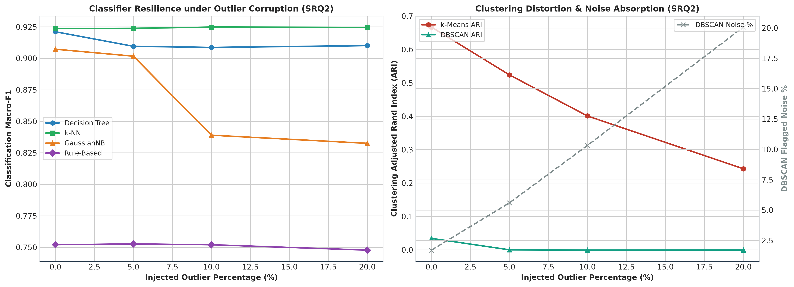
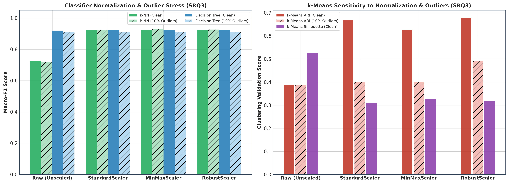
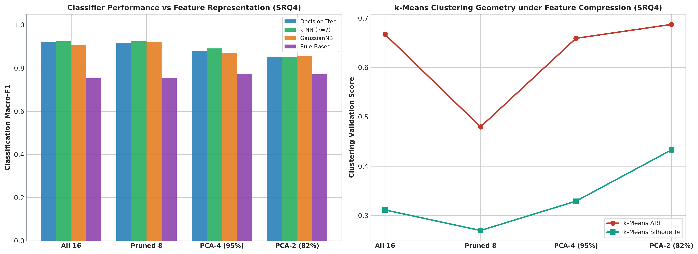

# Surviving Imperfect Data: A Multi-Dimensional Robustness Stress Test of Data Mining Pipelines on Morphological Dry Bean Features

[](https://www.python.org/downloads/)
[](https://scikit-learn.org/)
[](https://doi.org/10.24432/C50S4B)
[](https://www.ewubd.edu/)
[](https://colab.research.google.com/github/zubayearBK/cse477-dry-bean-stress-test/blob/main/notebooks/project_analysis.ipynb)

---

## Academic & Course Metadata

| Field | Details |
| :--- | :--- |
| **Institution** | East West University --- Department of Computer Science and Engineering |
| **Course** | **CSE477 --- Data Mining** |
| **Semester & Section** | Fall 2026 \| **Section: 4** |
| **Instructor** | **Sanzana Karim Lora**, Lecturer, Department of Computer Science and Engineering |
| **Assigned Group Theme** | **Group 10 --- "The Data Mining Stress Test"** (*How Much Can a Data-Mining Model Survive?*) |
| **Research Title** | *Surviving Imperfect Data: A Multi-Dimensional Robustness Stress Test of Data Mining Pipelines on Morphological Dry Bean Features* |
| **Submitted By** | **Syed Zubayear Bin Khaled** (ID: `2023-2-60-107`) <br> **Md. Arifur Rahman Shihab** (ID: `2023-2-60-176`) |
| **GitHub Repository** | [https://github.com/zubayearBK/cse477-dry-bean-stress-test](https://github.com/zubayearBK/cse477-dry-bean-stress-test) |

---

## Research Overview & Core Mission

Standard data mining curricula and academic benchmarks prioritize maximizing classification accuracy on pristine laboratory datasets. However, real-world machine vision systems in industrial agriculture suffer from dirty lenses, fluctuating illumination, missing sensor telemetry, and calibration drift. 

Our mission as **Group 10 (The Data Mining Stress Test)** is to treat the benchmark UCI Dry Bean dataset ($N = 13{,}611$ raw records across $7$ botanical cultivars) as a controlled baseline ($100\%$ data quality) and systematically evaluate the degradation trajectories of foundational data mining algorithms under controlled data corruption.

```
"Do not start with an algorithm. Start with a question.
Do not ask only 'Which algorithm gives the highest score?'
Instead ask: 'Under what conditions does this method reveal useful patterns, and why?'"
```

---

## Architectural & Experimental Frameworks

### 1. End-to-End Data Mining Pipeline



### 2. Group 10 Stress-Test Experimental Design



---

## Visual Gallery of Signature Robustness Curves

The flagship scientific deliverable of Group 10 is our suite of **Data Mining Robustness Curves** tracking exact model degradation:

| Stress Test 1: Missing Data MCAR (SRQ1) | Stress Test 2: Outlier Corruption (SRQ2) |
| :---: | :---: |
|  |  |
| *Macro-F1 & k-Means ARI degradation across 0%--30% MCAR missingness comparing Median vs. k-NN imputation.* | *Decision Tree resilience vs. catastrophic k-Means centroid collapse (Delta ARI = -0.4242) and DBSCAN noise absorption.* |
| **Stress Test 3: Normalization Sensitivity (SRQ3)** | **Stress Test 4: Dimensionality & Collinearity (SRQ4)** |
|  |  |
| *Scale distortion proof: raw Euclidean distance drops k-NN F1 by 0.1985; RobustScaler preserves clustering under outliers.* | *Collinearity pruning boosts Gaussian Naïve Bayes F1 by +0.0136; PCA-2 compression causes severe boundary loss.* |

---

## Master Comparative Performance Matrix

| Model Algorithm | Mathematical Paradigm | Clean Baseline Macro-F1 | 30% MCAR Drop | 20% Outlier Drop | Raw Scale Distortion Drop | Optimal Operational Regime |
| :--- | :--- | :---: | :---: | :---: | :---: | :--- |
| **Decision Tree (Tuned)** | Axis-Aligned Inequalities | $0.9211$ | $-0.0648$ | **$-0.0110$** | **$-0.0014$** | Scale-invariant; extreme outlier pipelines. |
| **k-NN ($k=7$)** | Metric Space Majority | **$0.9237$** | $-0.0560$ | $+0.0009$ | **$-0.1985$** | Normalized pipelines; moderate missingness. |
| **Gaussian Naïve Bayes** | Probabilistic Product | $0.9072$ | **$-0.0232$** | $-0.0747$ | $-0.1403$ | De-correlated features; high missingness. |
| **Rule-Based Classifier** | Depth-Limited Tree | $0.7520$ | $-0.1458$ | $-0.0043$ | $0.0000$ | Human-auditable regulatory inspection. |
| **$k$-Means ($k=7$)** | Centroid WCSS | $0.6669^*$ | $-0.1049^*$ | **$-0.4242^*$** | $-0.2788^*$ | Clean, spherical, outlier-free clusters. |

*\*Clustering performance evaluated via Adjusted Rand Index (ARI).*

---

## Five High-Impact Research Findings

1. **The 100% BOMBAY Outlier Paradox:** Exactly $522/522$ `BOMBAY` grains ($100.0\%$) exceed the global $1.5\times\text{IQR}$ upper threshold for `Area` ($99{,}031.25$ pixels), yet `BOMBAY` achieves flawless $100\%$ precision and recall across every tested classifier. Blind global outlier filtering would have completely eradicated a valid biological variety.
2. **Raw Euclidean Distance Collapse & Area Hijacking:** The $75.5\text{M}\times$ scale disparity between `Area` ($\sim 10^5$) and `ShapeFactor2` ($\sim 10^{-3}$) causes raw Euclidean distance to collapse into a 1D pixel count sort ($1.51\%$ neighbor overlap with standardized space), dropping top-10 neighbor class purity from $89.37\%$ down to $64.39\%$ ($\Delta = -0.2498$).
3. **Naïve Bayes Performance Inversion:** Pruning 8 collinear size features ($r > 0.98$) reduces maximum VIF from $317{,}671.59$ to $18.44$ and directly **increases** Gaussian Naïve Bayes Macro-F1 from $0.9072$ to **$0.9208$** ($\Delta = +0.0136$) by restoring the validity of conditional independence.
4. **Decision Tree Invariance to Extreme Outliers:** Injected $+8\sigma$ spikes cause Decision Tree Macro-F1 to drop by only $1.10$ percentage points ($\Delta = -0.0110$, a $1.19\%$ relative drop at $20\%$ corruption) due to rank-order inequality splits, whereas $k$-Means centroids are forcefully dragged into empty space, collapsing ARI by $\Delta = -0.4242$ (from $0.6669$ to $0.2427$).
5. **High-Lift Morphological Signatures:** Quantile-discretized FP-Growth discovers `{Area_High + AspectRation_Low + roundness_Low} -> {Class_BARBUNYA}` with an exceptional Lift of **$10.0345$** ($\text{Conf} = 97.95\%$), while overlapping varieties (`SIRA` vs. `DERMASON`) yield high confidence but bounded lift due to high baseline prevalence.

---

## Dataset Attribution & Provenance

* **UCI Repository DOI:** [10.24432/C50S4B](https://doi.org/10.24432/C50S4B)
* **Primary Publication:** Koklu, M., & Ozkan, I. A. (2020). Multiclass classification of dry beans using computer vision and machine learning techniques. *Computers and Electronics in Agriculture*, 174, 105507. [https://doi.org/10.1016/j.compag.2020.105507](https://doi.org/10.1016/j.compag.2020.105507)
* **Dataset Mirror (Google Drive):** [Direct Download Link](https://docs.google.com/spreadsheets/d/1AEydjVjItMCaLwIYIttbSQa0ZHGTV4yA/edit?usp=sharing&ouid=111969229142560713820&rtpof=true&sd=true)

---

## Repository Architecture

```text
cse477-group10-stress-test/
├── data/
│   ├── original/
│   │   ├── Dry_Bean_Dataset.xlsx          # Original UCI raw Excel dataset
│   │   └── Dry_Bean_Dataset.txt           # Official metadata text file
│   └── cleaned/
│       └── dry_bean_cleaned.csv           # Deduplicated baseline (13,543 records)
├── notebooks/
│   └── project_analysis.ipynb             # Master executable research notebook (Stages 1-13)
├── src/
│   ├── __init__.py
│   ├── analysis.py                        # Core data loading, audit, and Stages 1-7 functions
│   └── stress_tests.py                    # Modular Stages 8-13 and 4 stress-test implementations
├── results/
│   ├── figures/                           # 16 publication-grade figures (300 DPI PNG + vector PDF)
│   │   ├── fig01_scaling_comparison.{png,pdf}
│   │   ├── ...
│   │   └── fig16_feature_reduction_stress.{png,pdf}
│   └── tables/                            # 22 machine-readable CSV tables + master metrics JSON
│       ├── metrics_summary.json
│       ├── master_comparative_analysis.csv
│       └── ...
├── report/
│   └── latex/
│       ├── main.tex                       # Master Overleaf-ready LaTeX research report
│       └── references.bib                 # 18 verified BibTeX academic references
├── requirements.txt                       # Exact pinned Python dependencies
├── PROJECT_CONTEXT.md                     # Single source of truth specification
└── README.md                              # This document
```

---

## Quickstart & Reproducibility Guide

### 1. Local Python Environment (Recommended)

```bash
# Clone repository
git clone https://github.com/zubayearBK/cse477-dry-bean-stress-test.git
cd cse477-dry-bean-stress-test

# Create virtual environment and activate
python -m venv .venv
# Windows:
.\.venv\Scripts\activate
# Linux/macOS:
# source .venv/bin/activate

# Install dependencies
pip install -r requirements.txt

# Run full research pipeline CLI
python -m src.analysis
```

### 2. Google Colab Execution

Open `notebooks/project_analysis.ipynb` in Google Colab directly via the badge above. The notebook includes automated Google Drive and GitHub repo cloning fallbacks in Code Cell 1 and Code Cell 2, enabling execution on free Colab instances with zero manual file uploads.

### 3. Overleaf LaTeX Compilation

1. Create a new blank project on [Overleaf](https://www.overleaf.com/).
2. Upload `report/latex/main.tex` and `report/latex/references.bib`.
3. Create a `figures/` directory inside your Overleaf project and upload the 16 figures from `results/figures/` (or compile with standard pdfLaTeX).
4. Select the standard **pdfLaTeX** compiler. The document will compile cleanly with Roman-numbered front matter, clickable DOI citations, and vector graphics.
